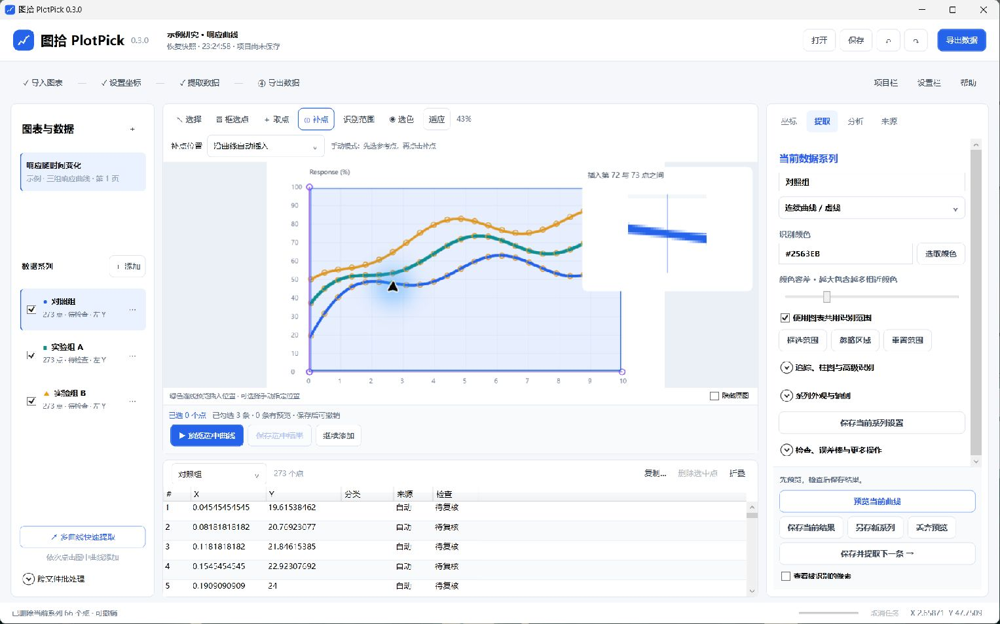
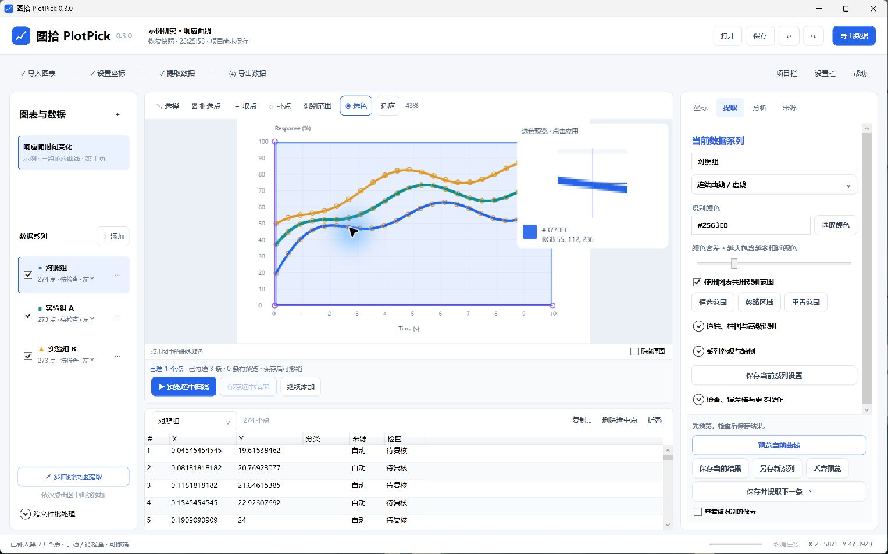
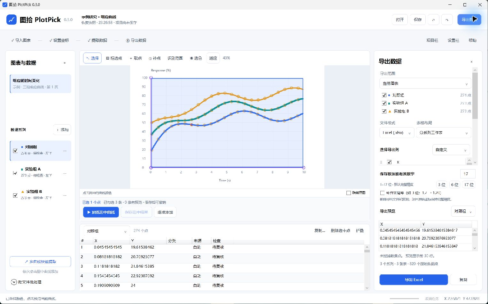

# 图拾 PlotPick

把论文图片里的曲线变成可编辑、可导出的数据。Windows 离线桌面软件，无账号、云服务或 API 密钥要求。

**[下载 Windows 版 v0.3.0（预览版）](https://github.com/Xhonesty/PlotPick/releases/tag/v0.3.0)** · [中文使用说明](docs/USER-GUIDE.md) · [更新说明](docs/RELEASE-0.3.0.md)

解压便携 ZIP 后运行 `PlotPick.exe`，或运行 Setup 安装包。无需安装 .NET SDK、Office 或 Python；请保留整个程序目录中的运行库与 OCR 模型。

## 主要功能

- 图片 / PDF / 截图导入，四点标定，线性、对数、日期及左右双 Y 轴。
- 多条曲线依次选色提取，预览后应用；散点、柱形与误差棒辅助识别。
- 沿曲线补点或指定插入位置；框选当前系列的点批量删除；撤销/重做保留缩放和平移。
- 标定步骤提示、原图像素选色预览、表格与画布联动、基础分析与重绘。
- 导出系列及列自由选择，支持 CSV / TSV / TXT / XLSX / JSON；可设 1–17 位有效数字。
- `.plotpick` 项目封装原图和数据，可移动、保存重开；自动保存恢复快照。

## 四步使用

1. **导入图表**：打开图片、PDF 或粘贴截图；首页内置三曲线示例。
2. **设置坐标**：填入已知刻度，按提示依次点击 X 起点、X 终点、Y 起点、Y 终点。
3. **提取与修正**：选色、预览并保存；用“补点”补齐遗漏，用“框选点”选中后删除。
4. **导出数据**：选择系列、布局、字段和有效数字，检查预览后导出；另存项目可继续编辑。

## 界面

补点保持原曲线的采集顺序；框选只作用于当前系列。



选色直接预览原图像素、十字中心及 HEX / RGB；四点标定也有固定提示和局部放大镜。



按需选择导出内容，调整列顺序、列名与有效数字。



以上为新版应用在 Windows 桌面中的实际截图，使用内置合成样图；标定画面见使用说明。

## 构建

C# / .NET 10 / WPF。将 .NET SDK **10.0.401** 解压到项目 `.tools/dotnet/`，在 Windows x64 执行：

```powershell
./scripts/build.ps1 -Test -Publish
```

使用 `-Offline` 可从已准备好的任务内依赖源构建；安装包另需 Inno Setup。依赖固定于各项目 `packages.lock.json`。完整步骤见 [构建说明](docs/BUILD.md)。

## 预览版边界

复杂交叉曲线、密集散点、扫描噪声、OCR 和误差棒需要人工复核。没有代码签名；干净 Windows 安装验收、真实系统 DPI 切换及十万点目标硬件性能仍待验证。项目格式保持版本 2，不兼容 GetData 私有工作区。

详见 [测试报告](docs/TEST-REPORT.md) 和 [已知限制](docs/KNOWN-LIMITATIONS.md)。

## 许可

PlotPick 自有代码采用 [MIT](LICENSE)。第三方组件、OCR 模型、运行库和样例数据保留原许可，详见 [第三方说明](THIRD-PARTY-NOTICES.md)。不包含 GetData 的代码或程序资源。
