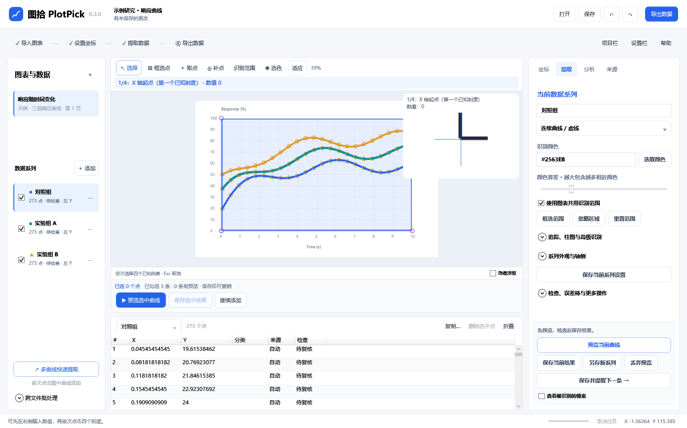

# 图拾 PlotPick 0.2 中文使用说明

## 安装与运行

便携包解压后运行 `PlotPick.exe`，保留整个目录。安装版默认安装到当前用户目录，不要求管理员权限。软件包含 .NET 运行时、PDFium、OpenCV 和中英文 OCR 模型，取数过程不需要网络、Office 或账号。

第一次启动可点击“试用三曲线示例”，或打开随包附带的 `samples/响应曲线.plotpick`。示例是自行生成的图像，不来自 GetData。

## 导入与图表管理

点击“打开”选择图片、PDF 或项目；可以拖入文件、Ctrl+V 粘贴剪贴板图片。PDF 输入页码、预览页面后以 300 或 600 DPI 导入，每次仅渲染选中的页面。多页 TIFF 作为多个图表进入项目。

来源面板的“框选并创建独立裁图”框选后创建独立图表。原图资源仍保留；来源面板可记录标题、DOI、图号和备注。左侧选择图表或系列；加号创建系列。来源面板和提取面板提供移除当前图表/系列，支持撤销。

先裁切、旋转或去倾斜，再标定通常更方便。已取点的图像旋转会同步变换标定点与数据点；更换源图需要重新标定和核对。

## 四点标定

1. 选择 X/Y 的轴类型，输入两个已知 X 刻度和两个已知 Y 刻度。
2. 点击“设置坐标刻度”，依提示点击 X1、X2、Y1、Y2 的实际刻度位置。四点不要求落在轴端点。
3. 采用对数轴时所有刻度必须为正。反向轴直接填写反向数值。日期轴先指定完整格式，例如 `yyyy-MM-dd`。
4. 双 Y 轴先标定左轴，再切换右侧 Y 轴并标定；系列属性中明确勾选绑定右轴。
5. “添加标定检查点”输入已知数据并点击其图像位置，校验报告显示像素残差。

OCR 只提供候选数值和文字位置。关闭候选列表后，人工核对并填写采用值；还需点选真实刻度位置才能完成标定。关闭或取消建议不会改变已有标定。

## 手动取数与修正

选择“取点”后点击曲线；可开启附近颜色吸附，精细定位时关闭吸附。选择模式可拖动点、框选点；方向键移动 1 原图像素，Shift+方向键移动 10 像素。Delete 删除选择，Ctrl+Z/Ctrl+Y 撤销/重做。

表格和画布选择联动。表格修改 X/Y 会通过坐标逆变换更新图像位置；日期遵循当前格式，无效数值撤回并显示状态提示。锁定系列或派生系列不能直接编辑。点位置修正会同步移动其误差端点。

滚轮以鼠标位置缩放，空格拖动平移，F 适应窗口，按住 B 暂看原图。项目栏、属性栏和下方表格可折叠。

## 自动提取

提取面板选择曲线、散点、纵向柱或横向柱；用吸管选色，调整容差，框选识别区域并排除图例/文字。需要时开启亮度模式或网格抑制。

- 曲线：默认逐列区域采样。指定起点后沿骨架双向追踪，遇到分支停止；复杂交叉请拆分系列处理。
- 虚线：保留缺失段标记，不会在长缺口中伪造采样点。
- 散点：调整连通区域最小/最大面积，结果为中心位置，不执行曲线重采样。
- 柱状图：选择方向、点击基线，再生成预览。正/负柱端分别读取。分组柱按颜色建多系列，分类名在表格中编辑。

“预览当前曲线”不会马上覆盖系列。检查预览/掩膜后点“保存当前结果”；已有数据时会提示替换，可撤销。“丢弃预览”保留原数据。修改图表后应重新生成预览。自动点均标记待复核，核对后再标记系列已复核。

误差棒在已有点或柱上检测，使用当前选色和容差，端帽候选必须人工核对。也可先选点，再选择 X低/X高/Y低/Y高，点击端帽手动标注。高/低指数据数值，不是屏幕上下方向。这里记录的是原图误差棒，不是软件读取误差。

## 便捷提取多条曲线

完成一次标定后，点击左下“多曲线快速提取”，依次点击图中各曲线的颜色，每次添加独立系列；首次导入的空白系列会被复用。点“结束选色”，勾选要提取的系列，再点“预览选中曲线”。各曲线预览以自身颜色叠加显示，切换系列不会丢失其他预览。

坐标属于图表共用；颜色、容差、采样间距、追踪起点、柱图基线属于各自系列。默认共用识别范围，取消“使用图表共用识别范围”可单独框选。同色曲线须用独立范围或起点区分；选色本身不能判断曲线身份。

“保存选中结果”一次写入所有勾选系列的有效预览，任何系列缺少预览或参数已改变都会阻止写入。已有数据时先确认替换；可一次撤销。右侧“另存新系列”保留原数据；“保存并提取下一条”保存当前结果后新增系列并进入选色。参数在切换系列、预览和保存项目时保留。自动结果均待检查。

左侧勾选框仅控制批量提取；点系列名称切换当前系列，底部表格也可切换。省略号菜单控制显示、锁定或删除。锁定及派生系列不执行自动提取；批量保存前请取消勾选这些系列。

## 校验、分析与重绘

校验报告提示重复、越界、较大跳变、未复核点和标定检查残差，不会自动删除数据。“定位下一个待复核点”滚动表格并将对应点移入画布。

分析提供数量/范围/均值/样本标准差、移动平均、Savitzky–Golay、线性插值、线性/二至五阶多项式拟合。结果生成独立派生系列。修改其上游数据或标定会标记结果失效，需重新生成后导出。

插值要求 X 严格递增且唯一；重复 X 必须先处理，默认不外推。按 X 排序是显式操作，会改变回折曲线顺序。拟合在原始数值空间完成，对数坐标显示不自动改变拟合模型。

在分析面板填写标题、配置系列线型/点形和轴标签，导出 PNG、SVG 或 PDF。大量系列和较长分类名的排版仍属预览版本限制。

## 批处理

先用一张同版式图片完成标定、选色和识别范围，保存识别模板。点击“批量处理”选择模板和图片；只有确认所有刻度相同时才选择复用数值，否则逐图核对刻度。

批量结果全部待复核，默认导出只包含已标定、已复核数据。比例不匹配或无法识别的文件在汇总中显示失败；可以重新选择失败文件重试。取消保留此前已完成的图表。

## 保存、恢复与导出

Ctrl+S 保存 `.plotpick` 项目；项目包含源资源，移动到另一台机器仍可打开。覆盖保存保留上次版本 `.bak`。有改动时每 30 秒写入本地恢复快照，异常退出后下次启动提示恢复。正常关闭或保存后清理本项目快照。

点击“导出数据”打开右侧抽屉，按以下步骤操作：

1. 选择当前系列、当前图表或整个项目，也可逐项勾选。导出勾选与左侧提取勾选独立。
2. 选择 Excel、CSV、TSV、TXT 或 JSON。文本格式只允许一张表。
3. 选择布局：“分系列工作表”保持独立；“独立 XY 列对”按每系列采集顺序并排，短系列补空，同一行不表示相同 X；“共用 X 宽表”要求各系列 X 严格递增、唯一且匹配；“长表”将系列纵向排列，多系列时建议同时勾选系列名称。
4. 勾选需要的字段；可直接编辑列名，用左侧拖动手柄或上下箭头调整顺序。简洁预设只含 X/Y，多系列对比预设含系列名称/X/Y；完整预设包含来源和误差字段。未勾选字段不会额外附在隐藏工作表中。
5. 固定预览区展示前 30 行，可切换工作表。检查后导出或复制。多工作表不能一起复制，请改用独立列对/长表；下方数据区“复制…”默认仅选择当前系列。
6. 可保存个人预设，后续新项目沿用列配置；当前项目保存最后确认的导出配置。

共用 X 不能按行强行对齐不同采样。高级设置中可显式开启临时线性重采样，指定步长，仅支持 X/Y 两列，在系列共同范围内插值、不外推；原数据不变。日期轴的间距、容差及误差幅度单位为天。若不希望插值，使用独立 XY 列对。

“仅导出已检查的数据点”是可选过滤；跨文件批处理结果始终排除未检查点。过滤数量显示在预览说明中。导出预览上方的“保存数据的有效数字”支持 1–17 位，默认 17，可一键选择 3、6 或 17 位。输入后预览立即刷新；这是有效数字位数，不是小数位数。默认按最大有效位数输出，可勾选“补齐末尾零”（如 3 位时 1.2 → 1.20）。该设置作用于 CSV/TSV/TXT/JSON、Excel 和剪贴板，随项目及个人导出预设保存；项目原始坐标保持完整精度。无效输入会阻止数据导出与配置保存。Excel 使用数值单元格并设置显示格式，可继续计算。

显示精度与存储精度分开，数值使用小数点，日期导出 ISO 8601。不支持 GetData 私有项目格式。更高版本的 PlotPick 项目会被拒绝打开，避免覆盖损坏。

## 遇到问题

识别为空时先检查颜色、容差、ROI、面积限制和系列类型；可显示掩膜判断分割结果。交叉、遮挡、重叠散点和模糊扫描图需要人工修正。保存失败时原有项目仍保留，选择可写目录重试。

完整限制和已完成的验证分别见 `KNOWN-LIMITATIONS.md` 与 `TEST-REPORT.md`。

## 0.3：框选删除与补点

- **取点**始终在系列末尾追加。**补点**用于修正自动提取遗漏，不会按 X 全局重排。
- 默认沿现有曲线插入：把鼠标移到缺失位置，绿色连接线与放大镜标题预览插入到哪两个点之间，再点击。距离按屏幕逻辑像素计算（12 px），视图放大后可更精确地区分相邻路径。密集采样的同一路径会合并为候选；不同路径距离差小于 3 px 时提示人工选择。
- 手动模式：用选择工具或表格选中一个参考点，切到补点并选择“之前 / 之后”；或选择系列开头 / 结尾。连续点击会依次接在刚补入的点之后，保持点击顺序。
- 自动补点不跨已有断段。手动在断段边界插入时归入前一段，原后一段的边界仍保留；在系列开头插入则归入首段。散点及柱图使用手动位置。
- **框选点**与**识别范围**是两个独立工具。框选只选择当前系列内的点，普通拖框替换选择，Ctrl 拖框追加；画布高亮、表格选中和“已选 N 个点”同步。
- 按 Delete 或“删除选中点”一次删除，一次撤销即可恢复。文本输入框中的 Delete 不删除图表点。Esc 清除选择并取消当前工具。锁定及派生系列不能删点或补点。
- 新补点标记为手动、待复核。补点和删除会让关联派生系列失效，需要重新计算。
- 撤销/重做保留缩放和平移；每张图分别记住视图。按 F 或“适应”才主动适应窗口。

## 0.3：标定与选色预览

画布顶栏和放大镜顶部同时提示 1/4 到 4/4、X / Y / 右 Y、起终点以及当前刻度值。“起终点”是两个已知刻度，不必是物理轴端。取消或完成后提示消失。

单次选色和多曲线连续选色均显示局部像素、中心十字、颜色色块及 HEX / RGB。悬停只预览，点击才应用。颜色从原图读取，不受数据点、范围阴影或识别掩膜影响；移出图像不采样。
